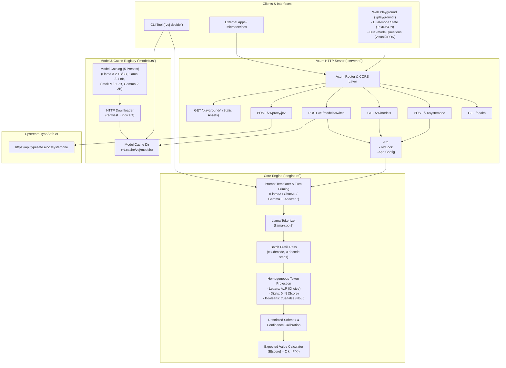
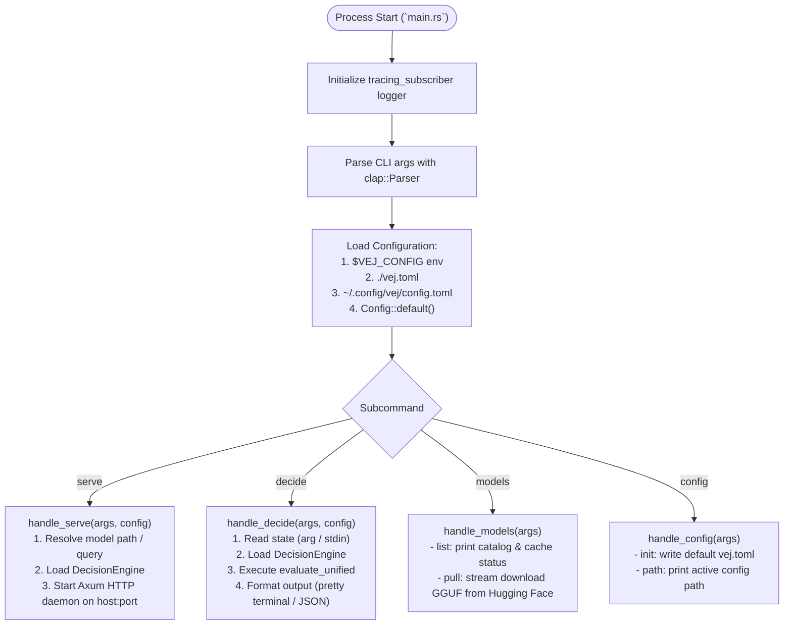
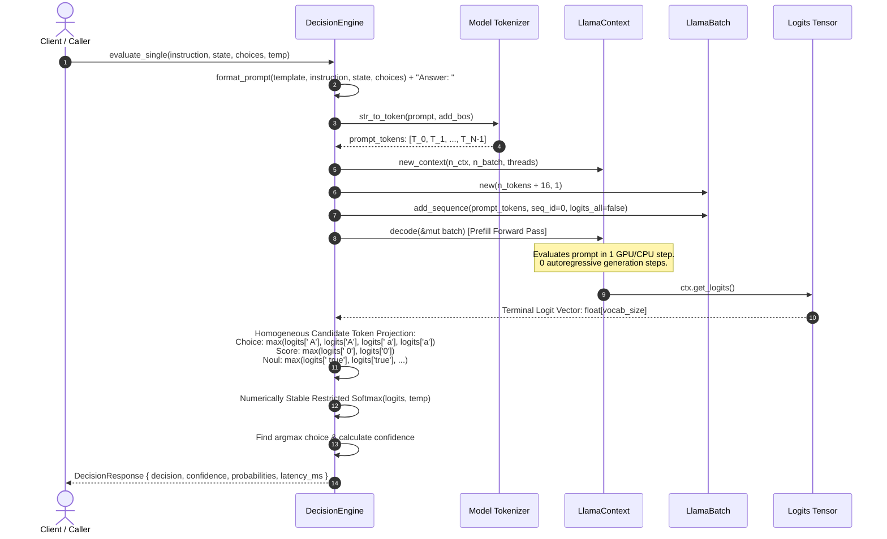
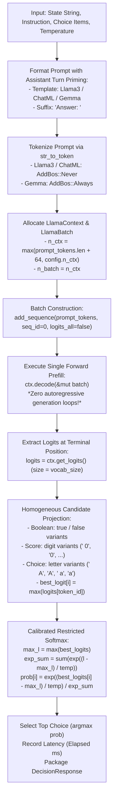
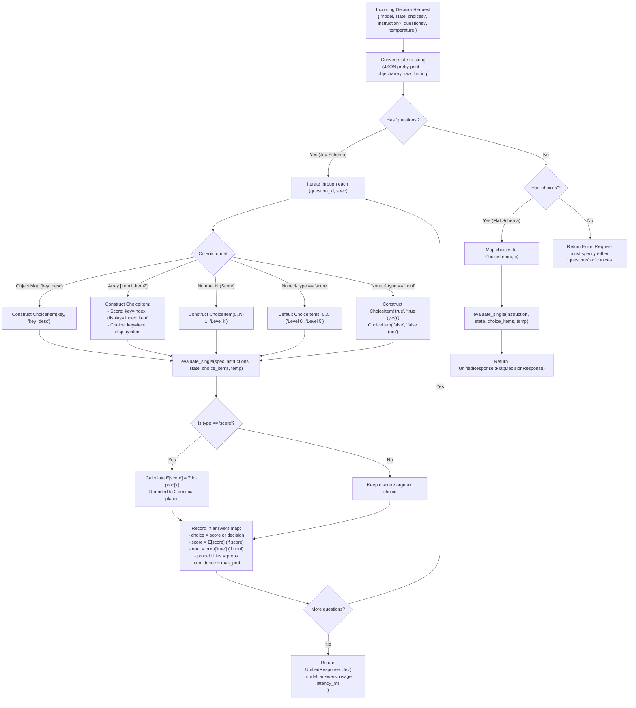
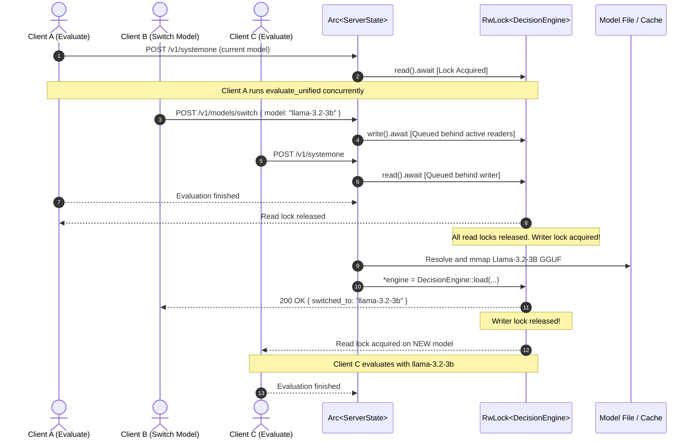
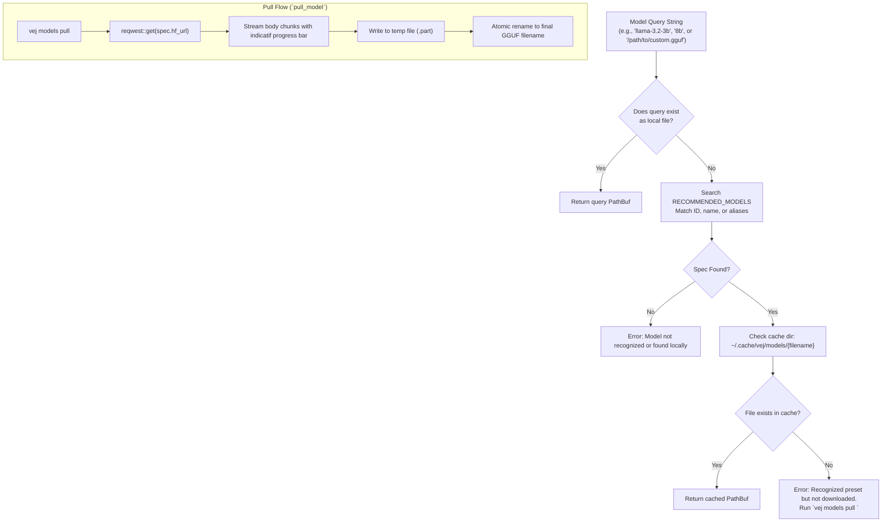
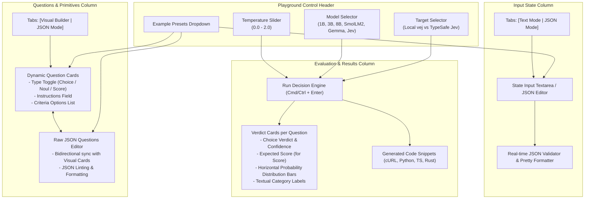

# `vej` — Program Logic & Architecture Specification

> **Source Code Reference:** Based on the codebase indexed in [`repomix-output.xml`](repomix-output.xml)  
> **Key Modules:** [`src/main.rs`](src/main.rs), [`src/engine.rs`](src/engine.rs), [`src/server.rs`](src/server.rs), [`src/models.rs`](src/models.rs), [`src/config.rs`](src/config.rs), [`src/cli.rs`](src/cli.rs), [`playground/src/app.js`](playground/src/app.js), [`playground/src/presets.js`](playground/src/presets.js)

---

## 1. Executive Overview & System Topology

`vej` is an ultra-low latency, zero-decode **System 1 Decision Engine** and local daemon compatible with TypeSafe AI's Jev API.

Unlike traditional autoregressive Large Language Model (LLM) servers that decode JSON token-by-token over dozens of iterations ($O(N)$ steps), `vej` performs **zero decode steps**. It evaluates the entire prompt in a **single forward prefill pass** ($O(1)$ generation), extracts raw logits at the terminal position, projects them strictly onto homogeneous candidate option tokens, and computes a **numerically stabilized, restricted softmax probability distribution**.

### System Architecture Diagram



---

## 2. Application Bootstrapping & Command Dispatch

The entry point [`src/main.rs`](src/main.rs) initializes logging, parses CLI arguments via [`src/cli.rs`](src/cli.rs), discovers configuration through [`src/config.rs`](src/config.rs), and delegates control to one of four subcommands: `serve`, `decide`, `models`, or `config`.

### Bootstrapping Lifecycle



### Pseudocode: Main Flow & Configuration Discovery

```text
FUNCTION main():
    initialize_logger()
    cli = Cli::parse_arguments()
    config = load_config_with_fallback()

    MATCH cli.command:
        CASE Serve(args):
            model_query = args.model OR config.default_model
            model_path = resolve_model_path(model_query)
            engine = DecisionEngine::load(
                model_path,
                model_id=model_query,
                gpu_layers=args.gpu_layers OR config.n_gpu_layers,
                threads=args.threads OR config.threads,
                ctx_size=config.n_ctx
            )
            run_server(engine, config, args.host, args.port)

        CASE Decide(args):
            state_text = read_state_from_args_or_stdin(args)
            model_query = args.model OR config.default_model
            model_path = resolve_model_path(model_query)
            engine = DecisionEngine::load(model_path, ...)
            request = DecisionRequest {
                state: state_text,
                choices: args.choices,
                instruction: args.instruction,
                temperature: args.temperature
            }
            response = engine.evaluate_unified(request)
            display_response(response, json_mode=args.json)

        CASE Models(args):
            handle_models_subcommand(args)

        CASE Config(args):
            handle_config_subcommand(args)
END FUNCTION
```

---

## 3. Core Engine: The Zero-Decode Decision Pipeline

The core engine in [`src/engine.rs`](src/engine.rs) calculates decisions directly from the model's logits at the boundary where the assistant emits its first token.

### 3.1 Prompt Formatting & Turn Priming

To completely eliminate conversational prefix bias (e.g., the model generating `"I"` for *"I would choose option..."* which would distort probability toward option `I`), `vej` employs **explicit assistant turn priming**:

```
<|begin_of_text|><|start_header_id|>system<|end_header_id|>

You are a precise, low-latency classification system. Evaluate the input state and criteria, then respond with ONLY the single letter of the best option.
<|eot_id|><|start_header_id|>user<|end_header_id|>

Input State:
"""
{state}
"""

Task: {instruction}

Available Options:
A) frontend_engineer: ...
B) backend_engineer: ...
C) full_stack_engineer: ...

Select the best option from [A, B, C, ...]:<|eot_id|><|start_header_id|>assistant<|end_header_id|>

Answer: 
```

By appending `Answer: ` at the end of the assistant turn, the next token in autoregressive continuation is strictly the answer identifier itself.

### 3.2 Homogeneous Candidate Token Projection

Earlier implementations mixed multi-token dictionary subwords (`" embedded"`, `" full"`) with single-letter tokens (`" A"`, `" B"`). Because common English words have high unconditional priors in pretraining corpora, this introduced severe algorithmic distortion.

`vej` enforces **homogeneous, balanced candidate spaces**:

| Question Category | Candidate Tokens Extracted | Rationale |
|:---|:---|:---|
| **Boolean (`noul`)** | `" true"`, `"true"`, `" True"`, `"True"` vs `" false"`, `"false"`, `" False"`, `"False"` | Balanced binary semantic pair |
| **Numeric (`score`)** | `" 0"`, `"0"`, `" 1"`, `"1"`, `" 2"`, `"2"`, ... | Homogeneous digit token space |
| **Categorical (`choice`)** | `" A"`, `"A"`, `" a"`, `"a"`, `" B"`, `"B"`, ... | Uniform single-character letter tokens, eliminating English word prior distortion |

### Step-by-Step Inference Logic



### Detailed Pipeline Flowchart



### Pseudocode: Inference Engine (`evaluate_single`)

```text
FUNCTION evaluate_single(instruction, state_str, choices, temperature):
    start_time = clock_now()

    // 1. Format prompt with assistant turn priming ("Answer: ")
    prompt = format_prompt(instruction, state_str, choices)

    // 2. Tokenize prompt without duplicate BOS tokens
    add_bos = (template == Gemma) ? Always : Never
    prompt_tokens = model.str_to_token(prompt, add_bos)
    n_tokens = prompt_tokens.length

    // 3. Setup context for single forward pass
    ctx_size = MAX(n_tokens + 64, self.n_ctx)
    ctx = model.new_context(n_ctx=ctx_size, n_batch=ctx_size, threads=self.threads)

    // 4. Batch prefill (all prompt tokens evaluated in parallel)
    batch = LlamaBatch::new(capacity=n_tokens + 16)
    batch.add_sequence(prompt_tokens, seq_id=0, logits_all=false)

    // 5. Single forward pass
    ctx.decode(batch)

    // 6. Read raw logits from the terminal prompt token
    vocab_logits = ctx.get_logits()

    // 7. Project candidate options to homogeneous token spaces
    is_boolean = (choices.length == 2 AND has_key("true") AND has_key("false"))
    is_numeric = (!is_boolean AND all_keys_parse_as_uint(choices))
    letters = ["A", "B", "C", "D", "E", "F", "G", "H", "I", "J", "K", "L", "M", "N", "O", "P"]

    candidate_logits = []

    FOR index, item IN enumerate(choices):
        variants = []
        IF is_boolean:
            IF item.key == "true":
                variants.push(" true", "true", " True", "True")
            ELSE:
                variants.push(" false", "false", " False", "False")
        ELSE IF is_numeric:
            k = trim(item.key)
            variants.push(" " + k, k)
        ELSE:
            // Categorical choices strictly map to letter tokens
            IF index < letters.length:
                let = letters[index]
                variants.push(" " + let, let, " " + lowercase(let), lowercase(let))

        best_logit = -INFINITY
        FOR var IN variants:
            tokens = model.str_to_token(var, AddBos::Never)
            IF tokens is not empty:
                tok_id = tokens[0]
                l = vocab_logits[tok_id]
                IF l > best_logit:
                    best_logit = l

        IF best_logit == -INFINITY:
            best_logit = -100.0 // fallback penalty for unmapped tokens

        candidate_logits.push(best_logit)
    END FOR

    // 8. Restricted Softmax calculation with numerical stabilization
    temp = (temperature <= 0.0) ? 1.0 : temperature
    max_logit = MAX(candidate_logits)
    exp_sum = SUM(exp((l - max_logit) / temp) FOR l IN candidate_logits)

    probabilities = HashMap()
    best_choice = choices[0].key
    max_prob = -1.0

    FOR index, item IN enumerate(choices):
        prob = exp((candidate_logits[index] - max_logit) / temp) / exp_sum
        probabilities[item.key] = prob
        IF prob > max_prob:
            max_prob = prob
            best_choice = item.key
    END FOR

    latency_ms = (clock_now() - start_time).in_milliseconds()

    RETURN DecisionResponse {
        decision: best_choice,
        confidence: max_prob,
        probabilities: probabilities,
        model: self.model_id,
        latency_ms: latency_ms,
        tokens_evaluated: n_tokens
    }
END FUNCTION
```

---

## 4. Dual-Schema Unified Evaluation (`evaluate_unified`)

`vej` supports two distinct payload conventions transparently in `POST /v1/systemone`:
1. **TypeSafe AI Jev Schema**: Nested `questions` map with structured `criteria` descriptions, boolean `noul` questions, or continuous `score` questions.
2. **Flat Schema**: Simplified payload with a flat `choices` list and root `instruction`.

### 4.1 Schema Normalization & Question Types

The engine transparently parses questions across multiple formats:

- **Criteria Aliases**: Accepts `criteria`, `options`, `choices`, or `levels`.
- **Criteria Types**:
  - **Object Map (`{ "opt_a": "desc A", "opt_b": "desc B" }`)**: Choices created as `ChoiceItem { key: "opt_a", display: "opt_a: desc A" }`.
  - **Array (`["None", "2 years", "4 years", ...]`)**: 
    - For `score` questions: maps index as key (`"0"`, `"1"`, ...), display as `"0: None"`, `"1: 2 years"`.
    - For `choice` questions: maps text directly.
  - **Number (`6`)**: For `score` questions, generates $N$ levels: `Level 0` through `Level N-1`.
  - **Omitted / Null Criteria**:
    - For `score`: defaults to levels `0` through `5`.
    - For `noul`: defaults to `true (yes)` and `false (no)`.
- **Instructions Format**: Supports either a raw string or an object (e.g., `{ "question": "...", "today": "..." }`), serializing object entries into line-separated instructions.

### 4.2 Scoring Mathematics (Expected Value Calculation)

For `score` questions, the engine calculates the mathematically calibrated expected score:

$$\text{score} = \sum_{k=0}^{M-1} k \cdot P(\text{level}_k)$$

The continuous expected score is rounded to 2 decimal places and returned alongside the discrete top choice:
```json
{
  "type": "score",
  "choice": "3.42",
  "score": 3.42,
  "confidence": 0.38,
  "probabilities": {
    "0": 0.02,
    "1": 0.05,
    "2": 0.12,
    "3": 0.38,
    "4": 0.28,
    "5": 0.15
  }
}
```

### Request Normalization Flowchart



### Pseudocode: `evaluate_unified`

```text
FUNCTION evaluate_unified(req):
    start_time = clock_now()
    state_str = serialize_state_to_string(req.state)

    IF req.questions is provided:
        answers = HashMap()
        total_tokens = 0

        FOR q_name, q_val IN req.questions:
            q_spec = parse_question_spec(q_val)
            choice_items = []
            is_score = (q_spec.q_type == "score")

            crit = q_spec.criteria OR q_spec.options OR q_spec.choices OR q_spec.levels

            IF crit is Object(map):
                FOR k, v IN map:
                    display = (v is empty) ? k : k + ": " + v
                    choice_items.push(ChoiceItem(key=k, display=display))
            ELSE IF crit is Array(list):
                FOR idx, item IN enumerate(list):
                    key = is_score ? String(idx) : item
                    display = is_score ? (idx + ": " + item) : item
                    choice_items.push(ChoiceItem(key=key, display=display))
            ELSE IF crit is Number(num) AND is_score:
                FOR lvl FROM 0 TO num - 1:
                    choice_items.push(ChoiceItem(key=String(lvl), display="Level " + lvl))

            IF choice_items is empty:
                IF is_score:
                    FOR lvl FROM 0 TO 5:
                        choice_items.push(ChoiceItem(key=String(lvl), display="Level " + lvl))
                ELSE IF q_spec.q_type == "noul":
                    choice_items.push(ChoiceItem(key="true", display="true (yes)"))
                    choice_items.push(ChoiceItem(key="false", display="false (no)"))
                ELSE:
                    THROW Error("Question must define criteria options")

            // Format instructions from String or Object
            instr_str = format_instructions(q_spec.instructions)

            single_res = evaluate_single(
                instruction=instr_str,
                state_str=state_str,
                choices=choice_items,
                temperature=req.temperature
            )

            total_tokens += single_res.tokens_evaluated

            noul_val = (q_spec.q_type == "noul") ? single_res.probabilities["true"] : null

            IF is_score:
                expected_score = SUM(parseFloat(k) * prob FOR k, prob IN single_res.probabilities)
                rounded_score = round(expected_score, 2)
                score_val = rounded_score
                display_choice = format("%.2f", rounded_score)
            ELSE:
                score_val = null
                display_choice = single_res.decision

            answers[q_name] = AnswerOutput {
                q_type: q_spec.q_type,
                choice: display_choice,
                noul: noul_val,
                score: score_val,
                probabilities: single_res.probabilities,
                confidence: single_res.confidence
            }
        END FOR

        RETURN UnifiedResponse::Jev(JevResponse {
            model: self.model_id,
            answers: answers,
            usage: UsageInfo { input_tokens: total_tokens, output_tokens: 0 },
            latency_ms: (clock_now() - start_time).in_milliseconds()
        })

    ELSE IF req.choices is provided:
        choice_items = [ChoiceItem(key=c, display=c) FOR c IN req.choices]
        flat_res = evaluate_single(
            instruction=req.instruction,
            state_str=state_str,
            choices=choice_items,
            temperature=req.temperature
        )
        RETURN UnifiedResponse::Flat(flat_res)

    ELSE:
        THROW Error("Must provide 'questions' or 'choices'")
END FUNCTION
```

---

## 5. Server Concurrency & Hot-Switching Architecture

[`src/server.rs`](src/server.rs) implements an asynchronous HTTP service using Axum, Tokio, and Tower-HTTP.

### Concurrency Model

The server wraps `DecisionEngine` inside a `tokio::sync::RwLock` housed within `ServerState`:
- **Read Path (`engine.read().await`):** Multiple incoming decision requests acquire shared read locks and execute inference concurrently.
- **Write Path (`engine.write().await`):** When a request requests a model switch (either explicitly via `POST /v1/models/switch` or dynamically via the `model` field in `POST /v1/systemone`), a writer lock is acquired. This halts incoming inferences, hot-swaps the underlying memory-mapped GGUF weights, and resumes traffic seamlessly.



### Server Endpoint Routing Table

| HTTP Method | Route | Handler | Purpose |
|:---|:---|:---|:---|
| `GET` | `/health` | `health_handler` | Liveness check, active model ID, version |
| `POST` | `/v1/systemone` | `decision_handler` | Main decision endpoint (evaluates Jev / flat requests, supports per-request dynamic model loading) |
| `GET` | `/v1/models` | `list_models_handler` | Returns catalog of recommended models and local download status |
| `POST` | `/v1/models/switch` | `switch_model_handler` | Explicit hot-swap of the currently loaded model |
| `POST` | `/v1/proxy/jev` | `jev_proxy_handler` | Transparent proxy forwarding requests directly to TypeSafe AI upstream |
| `GET` | `/` | `root_handler` | Redirects browser requests (`Accept: text/html`) to `/playground/` |
| `GET` | `/playground/*` | `ServeDir` | Serves Vite-bundled frontend GUI |

---

## 6. Model Catalog & Caching Subsystem

[`src/models.rs`](src/models.rs) manages model resolution, Hugging Face downloads, and cache directory management.



### Supported Preset Catalog

| Model ID | Full Name | Vendor | Weights Size | Template Style | Hugging Face Repository |
|:---|:---|:---|:---|:---|:---|
| `llama-3.2-1b` | `Llama-3.2-1B-Instruct` | Meta (USA) | ~0.75 GB | `TemplateStyle::Llama3` | `bartowski/Llama-3.2-1B-Instruct-GGUF` |
| `smollm2-1.7b` | `SmolLM2-1.7B-Instruct` | Hugging Face (USA/FR) | ~1.05 GB | `TemplateStyle::ChatML` | `bartowski/SmolLM2-1.7B-Instruct-GGUF` |
| `llama-3.2-3b` | `Llama-3.2-3B-Instruct` | Meta (USA) | ~2.02 GB | `TemplateStyle::Llama3` | `bartowski/Llama-3.2-3B-Instruct-GGUF` |
| `llama-3.1-8b` | `Llama-3.1-8B-Instruct` | Meta (USA) | ~4.92 GB | `TemplateStyle::Llama3` | `bartowski/Meta-Llama-3.1-8B-Instruct-GGUF` |
| `gemma-2-2b` | `Gemma-2-2B-IT` | Google (USA) | ~1.63 GB | `TemplateStyle::Gemma` | `bartowski/gemma-2-2b-it-GGUF` |
| `gemma-2-9b` | `Gemma-2-9B-IT` | Google (USA) | ~5.44 GB | `TemplateStyle::Gemma` | `bartowski/gemma-2-9b-it-GGUF` |
| `gemma-4-e2b` | `Gemma-4-E2B-IT` | Google (USA) | ~1.85 GB | `TemplateStyle::Gemma4` | `bartowski/gemma-4-E2B-it-GGUF` |

---

## 7. Web Playground Architecture & Dual-Mode JSON System

[`playground/`](playground/) contains the reactive, single-page web playground for interactive testing and side-by-side comparison between local `vej` and hosted TypeSafe AI `jev`.



### 7.1 Key Playground Capabilities:
1. **Dual Input State Editing**:
   - **Text Mode**: Plain string input for unformatted text, logs, or raw prompt states.
   - **JSON Mode**: Structured JSON state with live parsing error indicators and a **"Format JSON"** auto-beautifier.
2. **Dual Questions & Primitives Editing**:
   - **Visual Builder**: Card-based interface for creating and modifying questions, picking question types (`choice`, `noul`, `score`), and adding/removing criteria rows.
   - **JSON Editor**: Direct JSON editor matching the TypeSafe AI Jev schema. Any changes in the JSON editor automatically sync to the visual builder and vice versa.
3. **TypeSafe AI Jev Benchmark Presets**:
   - **Resume Screening**: 7-question benchmark evaluating candidates (Sasha Bernoulli profile) across years of experience, technical depth, mentorship, LLM product development, open source contributions, career progression, and primary talent profile.
   - **Customer Support Triage**, **Perimeter Security Firewall**, **Agent Error Recovery**, **Noul Safety Policy Check**, and **Urgency & SLA Routing**.
4. **Natural Probability Calibration**:
   - Supports adjustable temperature (recommended `0.7 – 0.8` for multi-class classification) producing smooth distributions mirroring hosted Jev.

### 7.2 Preset Loading & State Synchronization Lifecycle

To prevent cross-preset questionnaire leaking, `loadPreset(id)` enforces a strict synchronization sequence:
1. **Immediate DOM Value Assignment**: The active state and questions JSON strings are immediately written to `stateTextarea.value` and `questionsJsonEditor.value`.
2. **Visual Builder Synchronization**: `renderQuestionsBuilder()` executes against the clean, newly parsed question definitions.
3. **Mode Auto-detection & Serialization**: `setStateMode` runs, which triggers `syncToRawJson()`. Because the editors already contain the fresh data, background payload construction reads the correct state.
4. **Payload Construction Purity**: `buildPayload()` functions as a pure reader without mutating `this.questions` as a side effect.
5. **Stale Verdict Reset**: `this.results = null; this.renderResults();` resets the verdict panel back to the clean "Ready for Decision" empty state.

### 7.3 Directional Benchmark Comparison Metrics

When operating in **Dual Compare Mode**, the playground compares the latency of local `vej` against cloud `Jev`:
- **When Local `vej` is Faster**: Renders a green benchmark banner reporting the local acceleration ratio:
  $$\text{Ratio} = \frac{\text{Latency}_{\text{Jev}}}{\text{Latency}_{\text{vej}}} \implies \text{e.g. "2.4x faster locally"}$$
- **When Hosted `Jev` is Faster**: Renders a cloud-accented banner reporting the cloud speed ratio rather than an inverted sub-1.0 "speedup":
  $$\text{Ratio} = \frac{\text{Latency}_{\text{vej}}}{\text{Latency}_{\text{Jev}}} \implies \text{e.g. "hosted Jev was 2.0x faster"}$$
- **When Latencies are Equal**: Renders an informative neutral indicator.

---

## 8. Mathematical Model: Restricted Logit Softmax vs Generative LLM

### 1. Traditional Autoregressive Generation (Inefficient)
A generative LLM generates responses token-by-token:
$$P(y_1, y_2, \dots, y_N \mid x) = \prod_{t=1}^N P(y_t \mid x, y_{<t})$$
- Generates 50–200 tokens of JSON formatting boilerplate (`{"decision": "refund", "confidence": 0.95}`).
- Decodes at 30–80 ms per token $\rightarrow$ Total latency: **1,500–6,000 ms**.
- The confidence score is a hallucinated string emitted by the model rather than true activation probabilities.

### 2. `vej` Restricted Softmax (Zero-Decode)
`vej` feeds the formatted prompt $x$ and evaluates the model's logits at the single prompt completion boundary:
$$z = \text{ForwardPass}(x)$$
For a discrete set of $K$ candidate options $\{c_1, c_2, \dots, c_K\}$, each candidate's logit $z_i$ is mapped to the maximum logit across its valid homogeneous token variants:
$$z_i = \max_{v \in \text{Variants}(c_i)} \text{Logit}(\text{Token}(v))$$
To prevent exponential overflow in floating-point math, logits are stabilized by subtracting $z_{\max} = \max_k z_k$:
$$z'_i = z_i - z_{\max}$$
The calibrated probability for choice $c_i$ under temperature $T$ is computed strictly over the restricted candidate set:
$$P(c_i) = \frac{\exp\left(\frac{z'_i}{T}\right)}{\sum_{j=1}^K \exp\left(\frac{z'_j}{T}\right)}$$
- Total forward passes: **1 (prefill batch only, 0 decode steps)**.
- Latency: **5–25 ms** on Apple Silicon GPU / NVIDIA CUDA.
- Confidence: **Exact, mathematically grounded probability distribution**.
- Failure mode: **Zero chance of invalid options or malformed JSON**.

---

## 9. Summary Comparison Matrix

| Property | Standard LLM (Ollama / vLLM / OpenAI) | `vej` (Zero-Decode System 1) |
|:---|:---|:---|
| **Forward Passes** | 1 prefill + $N$ autoregressive decode steps ($N \approx 50\text{--}200$) | **1 single prefill pass (0 decode steps)** |
| **Typical Latency** | 500 ms – 5,000 ms | **5 ms – 25 ms** |
| **Output Type** | Unstructured text / Free-form JSON | **Strictly typed choice & probability distribution** |
| **Scoring Output** | Hallucinated numeric string | **Expected value $E[\text{score}] = \sum k \cdot P(k)$** |
| **Confidence Metric** | Hallucinated text string in JSON | **Calibrated Restricted Softmax from raw model logits** |
| **JSON Schema Compliance** | Subject to parsing errors & hallucinations | **100% Guaranteed valid selection** |
| **Memory Footprint** | Dynamic KV cache grows with generation length | **Fixed prompt-length KV cache, freed immediately** |
